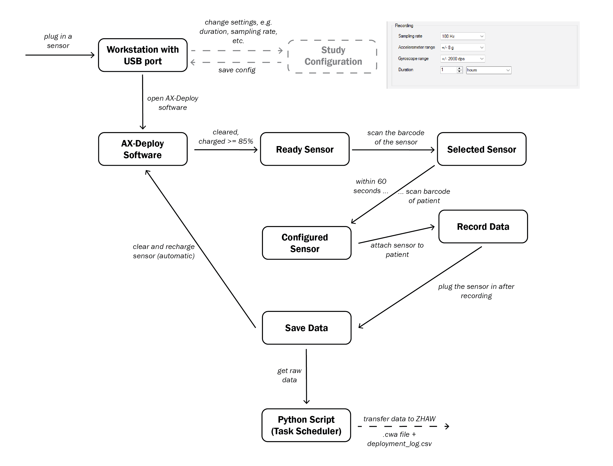

# D-BOOST2 – Sensor Workflow

This document describes the workflow for issuing, recording and returning Axivity AX6 sensors with the modified **AX-Deploy software** and the **Study Configuration** tool.

---

## Components

| Component | Description |
|---|---|
| **Workstation with USB port** | Windows PC to which the sensors are connected. Runs both programs. |
| **Study Configuration** (`ConfigEditor.exe`) | Defines the recording settings for the whole study and saves them to `config.ini`. Used rarely, e.g. once per study. |
| **AX-Deploy software** (`Deploy.exe`) | Used daily by the staff. Downloads, clears, charges and configures the sensors. The current recording settings are shown in the window title. |
| **Python Script (Task Scheduler)** | Runs automatically at scheduled times and transfers the downloaded raw data to ZHAW. |

---

## 1. Study configuration (once per study)

The recording settings are the same for all sensors in a study. They are set in the **Study Configuration** tool and saved to `config.ini` (`Documents\AX3\config.ini`).

| Setting | Example | Note |
|---|---|---|
| Sampling rate | 100 Hz | 12.5–1600 Hz |
| Accelerometer range | ±8 g | 2, 4, 8 or 16 g |
| Gyroscope range | ±2000 dps | Off, 125, 250, 500, 1000 or 2000 dps |
| Duration | 7 days | Hours or days |
| Minimum battery | 85 % | Sensor is only ready above this level |
| Data folder | `C:\AX3\data` | Downloaded files and deployment log |

With the gyroscope enabled at 100 Hz, the AX6 battery lasts approx. 7 days. The tool shows a warning if the settings exceed this.

After changing the settings, **AX-Deploy must be restarted** to apply them.

---

## 2. Preparing a sensor (automatic)

1. **Plug in a sensor** at the workstation and open the AX-Deploy software.
2. AX-Deploy automatically:
   - downloads any previous recording,
   - clears the sensor,
   - charges it until the battery is **≥ 85 %**.
3. The sensor is now a **Ready Sensor** (status *Charged*, LED magenta).

---

## 3. Issuing a sensor to a patient

1. **Scan the barcode of the sensor** → the sensor becomes the **Selected Sensor** and is highlighted in the device list.
2. **Within 60 seconds, scan the barcode of the patient** (format `P` + patient number, e.g. `P100042`).
   - If no patient barcode is scanned within 60 seconds, the selection expires and the sensor has to be scanned again.
3. AX-Deploy writes the patient number and the study settings to the sensor → **Configured Sensor** (LED flashing). The recording starts immediately.
4. Unplug the sensor and **attach the sensor to the patient**.

For several sensors per patient, repeat steps 1–4 for each sensor with the same patient barcode.

---

## 4. Recording

The sensor records data (**Record Data**) for the configured duration while it is worn by the patient.

---

## 5. Returning a sensor

1. **Plug the sensor in after recording.**
2. AX-Deploy automatically:
   - **saves the data** (**Save Data**) to the data folder,
   - then **clears and recharges the sensor**.
3. The sensor returns to the AX-Deploy software and is ready for the next patient.

### Saved files

| File | Content |
|---|---|
| `Patient_<patient>_Sensor_<sensor>_<date>.cwa` | Raw data of one recording, e.g. `Patient_100042_Sensor_6030111_2026-10-07.cwa`. The date is the start of the recording. |
| `deployment_log.csv` | One line per issued and per returned sensor (timestamp, event, patient, sensor, recording start/end, file name). Shows which sensor is currently with which patient. |

Files are never overwritten. If a file name already exists, `_1`, `_2`, … is appended.

---

## 6. Data transfer

The **Python script** is started by the Windows Task Scheduler and **gets the raw data** from the data folder to **transfer it to ZHAW**.

Notes for the script:
- Only transfer completed `.cwa` files. During a download the file is named `….cwa.part` and must be skipped.
- The files only contain the patient number, not the patient's name. The list linking patient numbers to real identities must not be transferred.

---

## Rules for daily use

- **Do not unplug** a sensor while it is downloading (LED white), clearing or being configured.
- After unplugging, **wait about 10 seconds** before plugging in again.
- **Error (LED blue):** unplug the sensor, wait 10 seconds, plug it in again. **Do not use F9 (reset).**
- Do not keep `deployment_log.csv` open in Excel while AX-Deploy is running. Open a copy instead.
